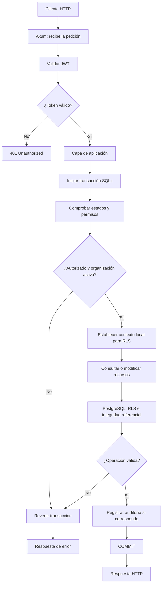

# Arquitectura de Atlas

## 1. Objetivo

Atlas es una API desarrollada en Rust con una arquitectura orientada a la separación de responsabilidades, la seguridad y el mantenimiento a largo plazo.

El sistema utilizará PostgreSQL como base de datos principal y adoptará un modelo multi-tenant en el que cada usuario pertenece como máximo a una organización.

La arquitectura inicial estará basada en una única aplicación desplegable, con posibilidad de ejecutar varias instancias en el futuro.

## 2. Principios arquitectónicos

- **Separación de responsabilidades:** cada capa tendrá una función claramente definida.
- **Seguridad por capas:** la autenticación, la autorización, las restricciones de integridad y PostgreSQL Row-Level Security (RLS) actuarán de manera complementaria.
- **Integridad de los datos:** las reglas que puedan garantizarse en PostgreSQL se respaldarán mediante restricciones de la base de datos.
- **Consistencia de autorización:** las nuevas operaciones protegidas deberán respetar el estado actual de la cuenta, la membresía, la organización y los permisos.
- **Trazabilidad:** los cambios de estado y otras operaciones relevantes deberán generar registros de auditoría.
- **Simplicidad operativa:** la primera versión utilizará una API y una base de datos, evitando distribuir prematuramente el sistema en múltiples servicios.

## 3. Tecnologías principales

| Componente | Tecnología |
|---|---|
| Lenguaje | Rust |
| Framework HTTP | Axum (propuesto) |
| Acceso a datos | SQLx (propuesto) |
| Base de datos | PostgreSQL |
| Aislamiento de filas | PostgreSQL Row-Level Security |
| Comunicación | HTTP y API REST (propuesto) |
| Pruebas de integración | PostgreSQL real y entorno de pruebas aislado |

Las tecnologías marcadas como propuestas deberán confirmarse antes de establecerlas como dependencias definitivas.

## 4. Organización por capas

### 4.1. Capa de presentación

Responsable de recibir las solicitudes HTTP y devolver las respuestas correspondientes.

Sus responsabilidades incluyen:

- Definir rutas y métodos HTTP.
- Extraer y validar los datos de entrada.
- Gestionar la identidad autenticada de la solicitud.
- Traducir los resultados de la aplicación a respuestas HTTP.
- Convertir los errores de aplicación en respuestas adecuadas.

Esta capa no deberá contener las reglas centrales de autorización ni acceder directamente a la base de datos para ejecutar casos de uso protegidos.

### 4.2. Capa de aplicación

Coordina los casos de uso de Atlas.

Sus responsabilidades incluyen:

- Ejecutar las operaciones solicitadas por los controladores.
- Coordinar la autorización requerida.
- Gestionar las transacciones necesarias.
- Coordinar las consultas y modificaciones de datos.
- Garantizar que las operaciones protegidas sigan el protocolo de seguridad establecido.
- Coordinar los cambios de estado y sus eventos de auditoría.

Los casos de uso deberán utilizar interfaces explícitas para acceder a las capacidades que necesitan, evitando depender directamente de detalles innecesarios de infraestructura.

### 4.3. Capa de dominio

Contiene las reglas y conceptos centrales del negocio.

Incluye conceptos como:

- Usuarios.
- Organizaciones.
- Membresías.
- Roles.
- Permisos.
- Proyectos y tareas.
- Estados de cuenta, membresía y organización.
- Reglas de autorización y restricciones del negocio.

El dominio deberá expresar las invariantes de Atlas sin depender directamente de Axum, SQLx o del protocolo HTTP.

### 4.4. Capa de infraestructura

Implementa los mecanismos técnicos que utiliza la aplicación.

Sus responsabilidades incluyen:

- Conexiones y transacciones PostgreSQL mediante SQLx.
- Consultas y persistencia de datos.
- Implementación de las interfaces de acceso a datos.
- Configuración de PostgreSQL RLS.
- Gestión de migraciones.
- Registro técnico de errores y eventos.
- Integración con servicios externos cuando sean necesarios.

## 5. Flujo de una solicitud protegida

1. El cliente envía una solicitud HTTP.
2. La capa de presentación valida el token de acceso e identifica al usuario.
3. La capa de aplicación inicia el caso de uso correspondiente.
4. Se comprueban el estado de la cuenta, la membresía, la organización y el permiso requerido.
5. La operación protegida coordina su ejecución mediante la transacción y el protocolo de concurrencia definidos para Atlas.
6. PostgreSQL aplica las restricciones de integridad y las políticas RLS correspondientes.
7. La aplicación devuelve el resultado mediante la capa de presentación.

La validación inicial del token no sustituye las comprobaciones de autorización contra el estado actual de la base de datos.

## 6. Autenticación y autorización

La autenticación identificará al usuario mediante un token de acceso validado por la API.

La autorización se basará en:

- El estado de la cuenta.
- El estado de la membresía.
- El estado de la organización.
- El rol asignado a la membresía.
- Los permisos concedidos a ese rol.
- La pertenencia del recurso a la organización autorizada.

Los identificadores enviados por el cliente no se considerarán prueba de autorización.

Los permisos no dependerán exclusivamente de las reclamaciones del token, ya que los cambios de rol y estado deberán reflejarse conforme a la política de consistencia definida para Atlas.

## 7. Aislamiento multi-tenant

Cada recurso que requiera aislamiento deberá tener una relación verificable con su organización propietaria.

La aplicación limitará las consultas al ámbito autorizado y PostgreSQL RLS actuará como defensa adicional para restringir las filas accesibles.

En el caso de las tareas, se almacenará `organization_id` además de la referencia al proyecto. Las restricciones de integridad deberán garantizar que la organización de la tarea coincida con la del proyecto asociado.

El contexto utilizado por RLS se establecerá de forma controlada y con alcance limitado a la transacción protegida.

## 8. Transacciones y concurrencia

Las operaciones protegidas deberán utilizar transacciones PostgreSQL cuando necesiten mantener un contexto de seguridad consistente.

La suspensión de una organización deberá coordinarse con todas las operaciones protegidas, incluidas las lecturas, según la política definida en ADR-004.

El mecanismo concreto de coordinación, los niveles de aislamiento y el tratamiento de operaciones en curso deberán validarse mediante pruebas de integración antes de considerarse completados.

Las operaciones externas a PostgreSQL requerirán mecanismos adicionales cuando sea necesario garantizar su coordinación con cambios de estado.

## 9. Auditoría

Los cambios de estado y otras operaciones relevantes deberán generar eventos de auditoría.

Cuando un evento corresponda a un cambio persistente, el registro del evento y la modificación deberán confirmarse en la misma transacción siempre que formen parte de la misma base de datos.

Los registros deberán permitir identificar al actor, la entidad afectada, la fecha y los datos necesarios para reconstruir el cambio.

El acceso a los registros de auditoría deberá limitarse para impedir modificaciones o eliminaciones no autorizadas.

## 10. Escalabilidad

La primera versión se desplegará como una única aplicación conectada a PostgreSQL.

La arquitectura deberá permitir ejecutar varias instancias de la API sin depender de estado de autorización exclusivamente local a una instancia.

La consistencia de permisos y estados se apoyará en PostgreSQL. No se introducirá una caché de autorización hasta que las mediciones demuestren una necesidad y se haya definido cómo mantener su consistencia.

## 11. Pruebas

La estrategia de pruebas incluirá:

- Pruebas unitarias para las reglas del dominio.
- Pruebas de aplicación para los casos de uso.
- Pruebas de integración con PostgreSQL real.
- Pruebas de políticas RLS y aislamiento entre organizaciones.
- Pruebas de integridad referencial.
- Pruebas de concurrencia para suspensiones y modificaciones de permisos.
- Pruebas de auditoría y de manejo de errores.

Las pruebas de seguridad deberán ejecutarse con un rol de base de datos equivalente al utilizado por la aplicación, evitando privilegios que puedan eludir RLS.

## 12. Decisiones relacionadas

- ADR-001: Usar PostgreSQL como base de datos.
- ADR-002: Aislamiento multi-tenant de datos.
- ADR-003: Un rol por membresía.
- ADR-004: Suspensión de organizaciones.

## 13. Estado de la arquitectura

Este documento describe la arquitectura prevista para Atlas. Las decisiones aceptadas se encuentran registradas en sus ADR correspondientes.

Los mecanismos técnicos que aún no han sido implementados o validados deberán considerarse pendientes hasta contar con pruebas que demuestren su funcionamiento.

## Flujo de trabajo de una solicitud protegida

