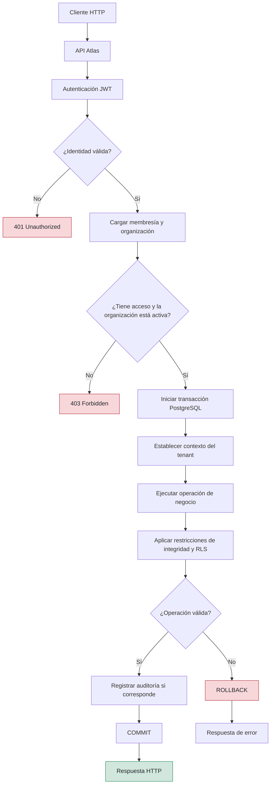
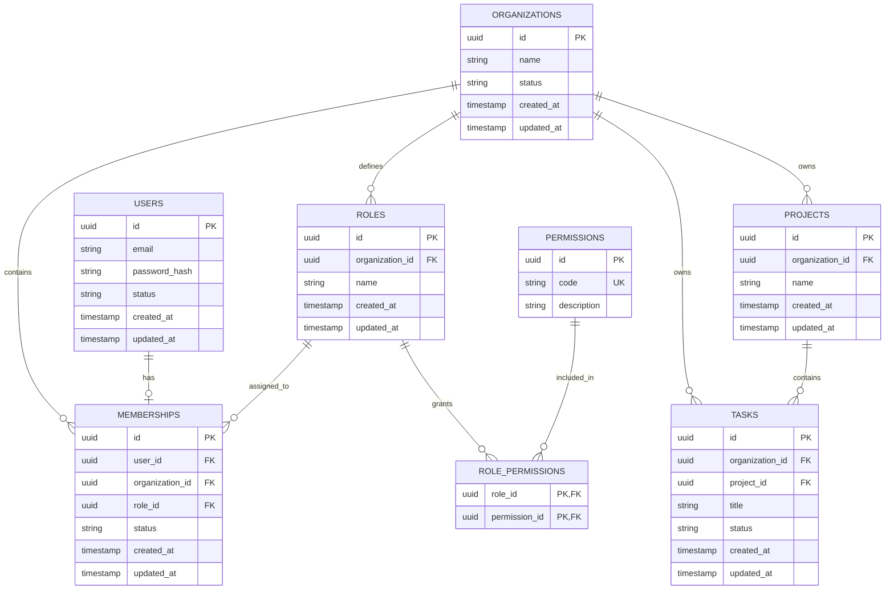

# Data Model — Atlas

## 1. Objetivo

Este documento define el modelo de datos de Atlas, incluyendo las entidades principales, sus relaciones, las restricciones de integridad y las reglas necesarias para garantizar el aislamiento entre organizaciones (*multi-tenancy*).

El modelo utiliza PostgreSQL como sistema de gestión de bases de datos, de acuerdo con la decisión registrada en [ADR-001](decisions/ADR-001-postgresql.md).

Este documento describe la arquitectura de datos propuesta. No implica que todas las entidades, restricciones o políticas estén implementadas actualmente.

## 2. Principios de diseño

- **Integridad referencial:** las relaciones entre entidades deben estar protegidas mediante claves foráneas y restricciones de PostgreSQL.
- **Aislamiento multi-tenant:** cada organización debe acceder únicamente a sus propios recursos.
- **Defensa en profundidad:** el aislamiento se aplica mediante consultas con alcance organizacional y Row-Level Security (RLS).
- **Consistencia transaccional:** las operaciones que modifican varias entidades relacionadas deben ejecutarse dentro de transacciones cuando corresponda.
- **Preservación de datos:** suspender una organización no elimina sus datos ni modifica automáticamente el estado individual de sus usuarios o membresías.
- **Auditoría:** los cambios relevantes deben conservar información sobre quién realizó la operación, cuándo ocurrió y qué cambió.
- **Restricciones explícitas:** las invariantes importantes deben reforzarse en la base de datos, no depender exclusivamente de validaciones en la aplicación.

## 2.1 Flujo de datos de Atlas

El siguiente diagrama representa el flujo conceptual de una solicitud que consulta o modifica datos. La API valida la identidad y los permisos, establece el contexto de la organización y delega las operaciones a PostgreSQL, donde se aplican las restricciones de integridad y las políticas RLS.

### Consideraciones

- La autenticación identifica al usuario, pero no concede automáticamente acceso a una organización.
- La autorización debe comprobar la membresía, el rol y los permisos aplicables.
- El estado de la organización debe comprobarse de acuerdo con la política de suspensión de Atlas.
- El contexto del tenant debe establecerse dentro de la transacción para evitar contaminación entre conexiones reutilizadas del pool.
- PostgreSQL aplica las restricciones de integridad y las políticas RLS configuradas para las tablas correspondientes.
- Los cambios y sus registros de auditoría deben confirmarse juntos cuando la operación requiera atomicidad.
- Este diagrama describe el diseño previsto, no una implementación ya verificada.

## 3. Entidades principales

### 3.1 Organization

Representa una organización dentro de Atlas y constituye la unidad principal de aislamiento de datos.

Responsabilidades:

- Identificar de forma única a cada organización.
- Mantener su estado operativo.
- Relacionarse con sus membresías, roles, proyectos y demás recursos.
- Permitir la suspensión y reactivación sin eliminar información.

Atributos conceptuales:

- `id`: identificador único.
- `name`: nombre de la organización.
- `status`: estado operativo.
- `created_at`: fecha de creación.
- `updated_at`: fecha de última modificación.

### 3.2 User

Representa la identidad global de una persona dentro de Atlas.

Responsabilidades:

- Mantener los datos de identidad y autenticación.
- Identificar al usuario independientemente de sus permisos dentro de una organización.
- Relacionarse con una membresía como máximo, según la política actual del sistema.

Atributos conceptuales:

- `id`: identificador único.
- `email`: dirección de correo electrónico, con una política de unicidad por definir.
- `password_hash`: hash de la contraseña, cuando corresponda.
- `status`: estado de la cuenta.
- `created_at`: fecha de creación.
- `updated_at`: fecha de última modificación.

### 3.3 Membership

Representa la asociación de un usuario con una organización y determina el rol que tiene dentro de ella.

Responsabilidades:

- Vincular un usuario con una organización.
- Asignar un único rol al usuario dentro de esa organización.
- Mantener un estado independiente del estado de la cuenta y de la organización.

Atributos conceptuales:

- `id`: identificador único.
- `user_id`: referencia al usuario.
- `organization_id`: referencia a la organización.
- `role_id`: referencia al rol asignado.
- `status`: estado de la membresía.
- `created_at`: fecha de creación.
- `updated_at`: fecha de última modificación.

La política actual establece que cada usuario puede pertenecer como máximo a una organización y tener un solo rol por membresía.

### 3.4 Role

Representa un conjunto configurable de permisos dentro de una organización.

Responsabilidades:

- Definir un rol organizacional.
- Asociarse con una única organización.
- Agrupar los permisos que determinan las operaciones autorizadas.

Atributos conceptuales:

- `id`: identificador único.
- `organization_id`: organización propietaria del rol.
- `name`: nombre del rol.
- `created_at`: fecha de creación.
- `updated_at`: fecha de última modificación.

La política de unicidad del nombre del rol debe definirse dentro del alcance de su organización.

### 3.5 Permission

Representa una capacidad reconocida por Atlas, como consultar proyectos o modificar tareas.

Ejemplos conceptuales:

- `project.read`
- `project.create`
- `project.update`
- `task.read`
- `task.create`
- `task.update`

La propuesta inicial es utilizar un catálogo de capacidades definido por Atlas. La autorización efectiva dependerá de los permisos asignados al rol de la membresía correspondiente.

La posibilidad de que las organizaciones definan permisos completamente personalizados queda pendiente de decisión.

### 3.6 RolePermission

Representa la relación entre roles y permisos.

Responsabilidades:

- Asociar un rol con múltiples permisos.
- Permitir que un mismo permiso se asigne a múltiples roles.
- Evitar asociaciones duplicadas.

Atributos conceptuales:

- `role_id`: referencia al rol.
- `permission_id`: referencia al permiso.

La combinación de ambos campos debe ser única.

### 3.7 Project

Representa un proyecto perteneciente a una organización.

Responsabilidades:

- Mantener la información del proyecto.
- Identificar a la organización propietaria.
- Relacionarse con sus tareas.
- Garantizar que sus recursos relacionados permanezcan dentro del mismo tenant.

Atributos conceptuales:

- `id`: identificador único.
- `organization_id`: organización propietaria.
- `name`: nombre del proyecto.
- `created_at`: fecha de creación.
- `updated_at`: fecha de última modificación.

### 3.8 Task

Representa una tarea asociada a un proyecto y a una organización.

Responsabilidades:

- Mantener la información de la tarea.
- Identificar directamente a la organización propietaria.
- Referenciar el proyecto al que pertenece.
- Impedir relaciones entre proyectos y tareas de organizaciones diferentes.

Atributos conceptuales:

- `id`: identificador único.
- `organization_id`: organización propietaria.
- `project_id`: proyecto al que pertenece.
- `title`: título de la tarea.
- `status`: estado de la tarea.
- `created_at`: fecha de creación.
- `updated_at`: fecha de última modificación.

La presencia de `organization_id` en `tasks` permite aplicar restricciones de integridad y políticas RLS directamente sobre la tabla.

## 4. Diagrama entidad-relación

**Nota:** el diagrama representa la estructura conceptual propuesta. Los tipos definitivos, las restricciones compuestas y las cardinalidades deben validarse al elaborar el esquema SQL.

## 5. Relaciones y cardinalidades

| Relación | Cardinalidad | Regla |
|---|---|---|
| Organization — Membership | 1:N | Una organización puede tener múltiples membresías. |
| User — Membership | 1:0..1 | Un usuario puede tener como máximo una membresía. |
| Organization — Role | 1:N | Cada rol pertenece a una organización. |
| Role — Membership | 1:N | Un rol puede asignarse a múltiples membresías. |
| Role — Permission | N:M | Se implementa mediante `role_permissions`. |
| Organization — Project | 1:N | Cada proyecto pertenece a una organización. |
| Organization — Task | 1:N | Cada tarea pertenece directamente a una organización. |
| Project — Task | 1:N | Cada tarea pertenece a un proyecto. |

## 6. Restricciones de integridad

### 6.1 Un usuario, como máximo una membresía

La tabla `memberships` debe tener una restricción `UNIQUE` sobre `user_id`.

Esto garantiza que un usuario no pueda pertenecer simultáneamente a múltiples organizaciones mediante varias membresías.

Si posteriormente se decide permitir múltiples organizaciones por usuario, esta restricción deberá revisarse y la política de autorización tendrá que especificar cómo se selecciona la organización activa.

### 6.2 El rol debe pertenecer a la misma organización

Una membresía no debe poder utilizar un rol perteneciente a otra organización.

Para garantizarlo mediante PostgreSQL:

- `roles` debe disponer de una clave única sobre `(organization_id, id)`.
- `memberships` debe relacionar `(organization_id, role_id)` con `(organization_id, id)` de `roles`.

Una validación exclusiva en la aplicación no sustituye esta restricción de integridad.

### 6.3 Una tarea y su proyecto deben pertenecer al mismo tenant

La tabla `tasks` debe incluir `organization_id` y `project_id`.

Para garantizar que la tarea y su proyecto pertenezcan a la misma organización:

- `projects` debe disponer de una clave única sobre `(organization_id, id)`.
- `tasks` debe tener una clave foránea compuesta `(organization_id, project_id)` que referencie `(organization_id, id)` en `projects`.

Dos claves foráneas independientes hacia `organizations` y `projects` no garantizan por sí solas que ambos recursos pertenezcan a la misma organización.

### 6.4 Evitar permisos duplicados

La combinación `(role_id, permission_id)` de `role_permissions` debe ser la clave primaria o tener una restricción `UNIQUE`.

### 6.5 Unicidad de roles

El nombre de un rol debe ser único dentro de su organización si la política funcional así lo requiere.

La restricción recomendada es `UNIQUE (organization_id, name)`, con una política de normalización de nombres definida antes de implementar el esquema.

## 7. Aislamiento multi-tenant

Atlas combinará dos mecanismos de aislamiento:

1. **Capa de aplicación:** las consultas y operaciones protegidas deben incluir el alcance de la organización autorizada.
2. **PostgreSQL Row-Level Security (RLS):** las políticas de la base de datos proporcionarán una segunda barrera frente a accesos a filas de otros tenants.

Las tablas que contengan recursos organizacionales, como `projects` y `tasks`, deberán contar con políticas RLS apropiadas. Las tablas adicionales que contengan información de una organización también deberán evaluarse individualmente.

El contexto de la organización utilizado por RLS debe establecerse de forma local a la transacción para evitar que una conexión reutilizada del pool conserve el contexto de una solicitud anterior.

Las políticas RLS no sustituyen la autenticación ni la autorización. La aplicación debe impedir que un usuario seleccione arbitrariamente un `organization_id` y obtenga acceso a una organización de la que no forma parte.

También deberán evaluarse los permisos del rol de conexión de PostgreSQL, el uso de `FORCE ROW LEVEL SECURITY` cuando corresponda y las excepciones administrativas.

Véase [ADR-002 — Multi-tenant Isolation](decisions/ADR-002-multi-tenant-isolation.md).

## 8. Suspensión de organizaciones

El estado de una organización controla si se permiten operaciones protegidas dentro de ella.

La política funcional acordada establece que:

- Una organización suspendida no puede realizar operaciones protegidas, incluidas las lecturas.
- La suspensión no elimina sus datos ni sus relaciones.
- La suspensión no cambia automáticamente el estado individual de los usuarios o las membresías.
- La reactivación de la organización no reactiva automáticamente cuentas o membresías suspendidas por separado.
- Los cambios de estado deben auditarse.

El mecanismo de concurrencia que garantiza el cumplimiento de esta política, incluso para operaciones que ya estén en curso, debe validarse por separado. La política funcional está aceptada; el protocolo técnico aún requiere validación.

Véase [ADR-004 — Organization Suspension](decisions/ADR-004-organization-suspension.md).

## 9. Índices iniciales

Los índices deben responder a las consultas reales y validarse mediante mediciones.

Índices candidatos:

- `memberships(user_id)`: búsqueda de la membresía de un usuario; también puede quedar cubierto por la restricción `UNIQUE`.
- `memberships(organization_id)`: listado de membresías de una organización.
- `roles(organization_id)`: consulta de roles organizacionales.
- `projects(organization_id)`: listado de proyectos por organización.
- `tasks(organization_id, project_id)`: consulta de tareas por organización y proyecto.

Las claves primarias y restricciones `UNIQUE` normalmente crean sus propios índices en PostgreSQL. No se deben duplicar índices sin una razón demostrable.

La existencia de una clave foránea no crea automáticamente un índice en las columnas de la tabla que la referencia. Por ello, los índices de las tablas dependientes deben evaluarse según las operaciones de consulta, eliminación y actualización.

La validación debe incluir `EXPLAIN (ANALYZE, BUFFERS)` con datos y consultas representativos.

## 10. Auditoría

Atlas deberá registrar las operaciones relevantes que cambien el estado del sistema, especialmente:

- Suspensión y reactivación de organizaciones.
- Cambios de roles y permisos.
- Suspensión y reactivación de cuentas o membresías.
- Cambios relevantes en proyectos y tareas.
- Otras operaciones sensibles definidas por los requisitos funcionales.

El registro de auditoría debería incluir, según el tipo de evento:

- Identificador del evento.
- Actor que realizó la operación.
- Organización afectada, cuando corresponda.
- Tipo de operación.
- Entidad afectada y su identificador.
- Fecha y hora.
- Valores anteriores y posteriores cuando sean necesarios.

Cuando una modificación y su evento de auditoría deban ser atómicos, ambos deben registrarse en la misma transacción de PostgreSQL.

Los detalles definitivos del esquema de auditoría quedan pendientes de diseño.

## 11. Referencias

- [ADR-001 — PostgreSQL](decisions/ADR-001-postgresql.md)
- [ADR-002 — Multi-tenant Isolation](decisions/ADR-002-multi-tenant-isolation.md)
- [ADR-003 — Role per Membership](decisions/ADR-003-role-per-membership.md)
- [ADR-004 — Organization Suspension](decisions/ADR-004-organization-suspension.md)

## 12. Estado del modelo

Este documento describe un modelo de datos propuesto para Atlas. Antes de considerarlo definitivo, se deben validar:

- El catálogo global de permisos frente a la posibilidad de permisos personalizados por organización.
- Los estados válidos de usuarios, membresías y organizaciones.
- La política de unicidad y normalización de correos electrónicos y nombres de roles.
- Los tipos y convenciones definitivos de identificadores.
- El esquema de auditoría.
- Las restricciones compuestas y políticas RLS en PostgreSQL.
- Las migraciones y pruebas de integridad del esquema.

Las decisiones funcionales aceptadas deben mantenerse diferenciadas de los mecanismos técnicos que aún requieren validación.
