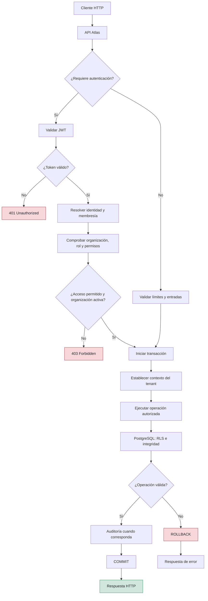

# Security — Atlas

## 1. Objetivo

Este documento define los principios, controles y requisitos de seguridad de Atlas. Su objetivo es proteger la identidad de los usuarios, controlar el acceso a los recursos, garantizar el aislamiento entre organizaciones y mantener la integridad y confidencialidad de los datos.

La seguridad debe aplicarse en varias capas: API, lógica de negocio y base de datos. Ninguna validación aislada debe considerarse suficiente para proteger el sistema.

Este documento describe la arquitectura de seguridad prevista; no implica que los controles estén implementados o auditados.

## 2. Principios de seguridad

- **Defensa en profundidad:** aplicar controles complementarios en la API, la aplicación y PostgreSQL.
- **Mínimo privilegio:** cada usuario y componente debe tener únicamente los permisos necesarios.
- **Denegación por defecto:** las operaciones protegidas deben rechazarse si no existe autorización explícita.
- **Aislamiento multi-tenant:** ninguna organización debe acceder a recursos pertenecientes a otra.
- **Validación en el servidor:** no confiar en los datos, identificadores ni permisos declarados por el cliente.
- **Integridad transaccional:** las operaciones sensibles deben preservar la consistencia de los datos.
- **Auditoría:** registrar los cambios relevantes y las acciones administrativas.
- **Gestión segura de secretos:** las claves y credenciales no deben almacenarse en el código fuente.
- **Errores controlados:** las respuestas públicas no deben revelar secretos, consultas SQL, trazas internas ni información sensible.

## 3. Modelo de amenazas

Atlas debe considerar, como mínimo, los siguientes escenarios:

| Amenaza | Control principal |
|---|---|
| Usuario sin autenticar intenta acceder a recursos protegidos | Autenticación y autorización obligatorias |
| Usuario modifica un identificador para consultar datos ajenos | Consultas con alcance organizacional y RLS |
| Usuario manipula el `organization_id` enviado por el cliente | Determinar la organización autorizada desde el contexto de identidad y membresía |
| Usuario intenta utilizar un rol de otra organización | Validación de autorización y claves foráneas compuestas |
| Organización suspendida continúa operando | Comprobación del estado y coordinación de concurrencia |
| Token expirado o manipulado | Validación criptográfica y temporal del JWT |
| Inyección SQL | Consultas parametrizadas y ausencia de concatenación insegura de entradas |
| Filtración de secretos | Variables de entorno, gestor de secretos y control de acceso |
| Abuso de endpoints públicos | Límites de solicitudes y controles específicos por endpoint |
| Cambios sensibles sin trazabilidad | Auditoría transaccional |
| Credenciales comprometidas | Hash seguro de contraseñas, rotación de secretos y revocación o expiración de sesiones |
| Acceso indebido mediante una conexión reutilizada | Contexto del tenant limitado a la transacción |

Este modelo inicial debe ampliarse cuando se definan los requisitos de despliegue, autenticación, administración y exposición pública de la API.

## 4. Flujo de seguridad de una solicitud

El flujo es conceptual. Los endpoints públicos y protegidos deben diferenciarse explícitamente, y las operaciones que no necesitan una transacción de base de datos no deben abrir una por obligación.

## 5. Autenticación

### 5.1 JSON Web Tokens (JWT)

La API utilizará JWT como mecanismo de autenticación para solicitudes protegidas, sujeto a la configuración definitiva de la implementación.

El servidor debe validar, como mínimo:

- La firma criptográfica del token.
- El algoritmo permitido, definido por configuración y no elegido libremente por el token recibido.
- La fecha de expiración (`exp`).
- La fecha de inicio de validez (`nbf`), cuando esté presente.
- El emisor (`iss`) y la audiencia (`aud`), cuando se definan para el sistema.
- La identidad del sujeto (`sub`).

Los tokens inválidos, expirados o manipulados deben rechazarse.

### 5.2 Contenido del token

El JWT debe incluir únicamente los datos necesarios para identificar y validar la sesión.

No debe contener contraseñas, secretos MFA ni datos personales innecesarios.

La organización, la membresía y los permisos efectivos deben validarse contra el estado vigente del sistema cuando la política de seguridad lo requiera. No se debe confiar indefinidamente en roles incluidos en un token si estos pueden cambiar o revocarse antes de su expiración.

La política de expiración, renovación y revocación de tokens queda pendiente de definición definitiva.

### 5.3 Firma y claves

Las claves de firma deben:

- Mantenerse fuera del repositorio.
- Obtenerse de variables de entorno o de un gestor de secretos.
- Tener suficiente entropía y longitud según el algoritmo utilizado.
- Rotarse mediante un procedimiento controlado.
- No aparecer en logs, mensajes de error ni respuestas HTTP.

Si se utiliza una clave simétrica, los servicios capaces de validar tokens y los capaces de firmarlos comparten material secreto. Debe evaluarse si ese modelo es adecuado para el despliegue previsto.

## 6. Contraseñas y autenticación multifactor

### 6.1 Contraseñas

Las contraseñas nunca deben almacenarse en texto plano ni cifrarse de forma reversible para autenticar usuarios.

Se utilizará un algoritmo específico para almacenamiento de contraseñas, como Argon2id o bcrypt, con parámetros adecuados al entorno y a la capacidad del servidor.

El proceso de autenticación debe evitar respuestas que permitan determinar fácilmente si una cuenta existe.

### 6.2 Autenticación multifactor (MFA)

Si Atlas utiliza TOTP para MFA:

- El secreto TOTP debe tratarse como información altamente sensible.
- El secreto pendiente de activación debe mantenerse separado del secreto activo.
- El MFA solo debe activarse después de validar el primer código.
- Los códigos de recuperación, si existen, deben almacenarse de forma segura.
- Deben aplicarse límites de intentos para evitar ataques de fuerza bruta.
- Los secretos TOTP no deben incluirse en logs ni respuestas posteriores a la configuración inicial.

La recuperación, desactivación y renovación del MFA requieren procedimientos autenticados y auditables.

## 7. Autorización basada en roles

Atlas utilizará roles asociados a las membresías de los usuarios.

La autorización deberá considerar:

1. La identidad autenticada.
2. La membresía del usuario.
3. El estado de la cuenta y de la membresía.
4. El estado de la organización.
5. El rol asignado a esa membresía.
6. El permiso requerido por la operación.
7. La pertenencia del recurso a la organización autorizada.

La posesión de un JWT válido no implica autorización universal.

Las rutas protegidas deben aplicar controles explícitos y denegar el acceso cuando no se pueda verificar una condición necesaria.

Véase [ADR-003 — Role per Membership](decisions/ADR-003-role-per-membership.md).

## 8. Aislamiento multi-tenant

El aislamiento entre organizaciones es un requisito de seguridad fundamental.

### 8.1 Capa de aplicación

Las consultas de recursos organizacionales deben incorporar el alcance de la organización autorizada. Los identificadores recibidos desde el cliente no deben utilizarse como prueba de pertenencia.

Por ejemplo, conocer el identificador de un proyecto no debe permitir consultarlo o modificarlo si pertenece a otra organización.

### 8.2 PostgreSQL Row-Level Security

RLS proporcionará una capa adicional de protección en las tablas que contengan datos organizacionales.

Las políticas deberán definirse de acuerdo con las operaciones de lectura, inserción, actualización y eliminación, usando las condiciones `USING` y `WITH CHECK` cuando corresponda.

Las relaciones entre tablas deben protegerse individualmente: RLS no se propaga automáticamente a todas las tablas relacionadas.

### 8.3 Contexto del tenant

El contexto organizacional debe establecerse de manera transaccional y en la misma conexión utilizada para las consultas protegidas.

Con SQLx y un pool de conexiones, el contexto no debe permanecer en una conexión después de finalizar la transacción.

Las variables de configuración personalizadas de PostgreSQL no deben tratarse como una frontera de seguridad absoluta frente a SQL arbitrario ejecutado con el rol de la aplicación. Por ello, también son necesarios:

- Consultas parametrizadas.
- Prevención de inyección SQL.
- Permisos mínimos en PostgreSQL.
- Separación de las credenciales administrativas.
- Evaluación de `FORCE ROW LEVEL SECURITY`.
- Pruebas de acceso cruzado entre organizaciones.

Véase [ADR-002 — Multi-tenant Isolation](decisions/ADR-002-multi-tenant-isolation.md).

## 9. Suspensión de organizaciones

La suspensión de una organización debe bloquear las operaciones protegidas, incluidas las lecturas, conforme a la política acordada.

La suspensión:

- No elimina datos.
- No modifica automáticamente los estados individuales de cuentas o membresías.
- Debe conservar las relaciones existentes.
- Debe generar un evento de auditoría.
- Debe impedir nuevas operaciones protegidas una vez que la suspensión tenga efecto.

La coordinación con operaciones que ya estén en curso requiere un protocolo de concurrencia validado. Una comprobación inicial del estado no basta para garantizar por sí sola que una operación concurrente no continúe después de una suspensión.

Las tareas en segundo plano, procesos externos y trabajos asíncronos requieren controles adicionales si pueden continuar actuando en nombre de una organización suspendida.

Véase [ADR-004 — Organization Suspension](decisions/ADR-004-organization-suspension.md).

## 10. Validación de entradas e inyección

Toda entrada externa debe validarse en el servidor, incluyendo:

- Parámetros de ruta y consulta.
- Cuerpos JSON.
- Identificadores de recursos.
- Valores de enumeraciones y estados.
- Límites de longitud y tamaño.
- Tipos y formatos esperados.

Las consultas SQL deben parametrizar sus valores. La construcción dinámica de nombres de tablas, columnas u órdenes de clasificación requiere listas permitidas explícitas cuando sea necesaria.

La validación de entradas no reemplaza la autorización: un identificador válido puede seguir apuntando a un recurso al que el usuario no tiene acceso.

## 11. Protección de la API

Se deben evaluar e implementar los siguientes controles según la exposición de cada endpoint:

- Límites de solicitudes para autenticación, MFA y operaciones sensibles.
- Tamaños máximos de cuerpos HTTP.
- Tiempos de espera y límites de recursos.
- CORS con orígenes explícitamente permitidos cuando se utilicen navegadores.
- HTTPS en todas las conexiones expuestas a redes no confiables.
- Respuestas de error que no filtren información interna.
- Protección frente a asignación masiva de campos en operaciones de escritura.
- Política explícita para endpoints públicos, protegidos y administrativos.

CORS no sustituye la autenticación ni constituye una barrera de acceso para clientes que no sean navegadores.

## 12. Seguridad de PostgreSQL

El usuario de base de datos utilizado por la API debe contar únicamente con los privilegios requeridos.

Requisitos:

- No utilizar una cuenta superusuario desde la aplicación.
- Evitar que el rol de la aplicación tenga `BYPASSRLS`.
- Restringir permisos de esquema, tablas, secuencias y funciones.
- Mantener separadas las credenciales de migración y las credenciales de ejecución cuando corresponda.
- Utilizar conexiones cifradas cuando la topología de despliegue lo requiera.
- No exponer PostgreSQL directamente a redes públicas sin una necesidad explícita y controles adecuados.
- Aplicar actualizaciones de seguridad y mantener copias de respaldo protegidas.
- Definir procedimientos de restauración y verificar periódicamente que los respaldos sean utilizables.

Las migraciones deben revisarse y ejecutarse mediante un proceso controlado.

## 13. Secretos y configuración

Los secretos de Atlas incluyen, entre otros:

- Claves de firma JWT.
- Credenciales de PostgreSQL.
- Claves de cifrado.
- Secretos MFA.
- Credenciales de servicios externos.

Los secretos no deben guardarse en el repositorio, imágenes de contenedores, archivos de ejemplo con valores reales ni registros de ejecución.

Los archivos `.env` deben excluirse del control de versiones cuando contengan secretos. Los ejemplos de configuración deben utilizar valores ficticios.

En producción se debe definir un mecanismo de provisión, rotación y revocación de secretos adecuado al entorno.

## 14. Auditoría y registro

Los eventos relevantes de seguridad y administración deben registrarse con suficiente información para reconstruir las acciones.

Ejemplos:

- Intentos de autenticación relevantes.
- Cambios de roles y permisos.
- Suspensión y reactivación de organizaciones.
- Cambios de estado de cuentas y membresías.
- Cambios de configuración de seguridad.
- Acciones administrativas sensibles.

Los registros deben evitar contraseñas, tokens completos, claves criptográficas, códigos MFA y otros secretos.

Los eventos de auditoría de una modificación de datos deben persistirse en la misma transacción cuando sea necesario garantizar que ambos cambios se confirmen o reviertan juntos.

También deben definirse controles de acceso, retención, integridad y protección de los registros.

## 15. Gestión de errores

Las respuestas HTTP deben comunicar el resultado sin exponer detalles internos.

Como criterio general:

- `400 Bad Request`: solicitud mal formada o inválida.
- `401 Unauthorized`: falta autenticación válida.
- `403 Forbidden`: identidad autenticada sin autorización suficiente.
- `404 Not Found`: recurso inexistente o, cuando la política lo requiera, recurso cuya existencia no debe revelarse.
- `409 Conflict`: conflicto con el estado actual del recurso.
- `429 Too Many Requests`: límite de solicitudes excedido.
- `500 Internal Server Error`: error interno no previsto.

La elección entre `403` y `404` para recursos de otros tenants debe ser coherente con la política de divulgación de información.

Los errores internos deben registrarse de forma controlada, sin incluir secretos ni datos sensibles innecesarios.

## 16. Pruebas de seguridad

Las pruebas deben cubrir tanto los casos permitidos como los intentos explícitos de acceso indebido.

Casos mínimos:

- Token ausente, malformado, expirado o con firma incorrecta.
- Usuario suspendido o membresía suspendida.
- Organización suspendida.
- Usuario que intenta acceder a recursos de otra organización.
- Membresía asociada a un rol de otra organización.
- Tarea asociada a un proyecto de una organización diferente.
- Consultas ejecutadas con un contexto de tenant incorrecto.
- Reutilización de conexiones del pool entre organizaciones.
- Operaciones de lectura y escritura protegidas por RLS.
- Inyección SQL en entradas externas.
- Intentos excesivos de autenticación y validación MFA.
- Consistencia entre cambios de datos y eventos de auditoría.
- Operaciones concurrentes durante la suspensión de una organización.

Las pruebas de aislamiento deben utilizar PostgreSQL real o un entorno equivalente que reproduzca fielmente RLS, las claves foráneas y las transacciones utilizadas en producción.

## 17. Referencias

- [ADR-001 — PostgreSQL](decisions/ADR-001-postgresql.md)
- [ADR-002 — Multi-tenant Isolation](decisions/ADR-002-multi-tenant-isolation.md)
- [ADR-003 — Role per Membership](decisions/ADR-003-role-per-membership.md)
- [ADR-004 — Organization Suspension](decisions/ADR-004-organization-suspension.md)

## 18. Estado de seguridad

Este documento define requisitos y controles previstos para Atlas. No representa una auditoría de seguridad ni confirma que la implementación cumpla actualmente todos los requisitos.

Antes de considerar la arquitectura lista para producción, se deberán validar, como mínimo:

- La configuración definitiva de autenticación y JWT.
- La gestión del ciclo de vida y revocación de sesiones.
- El almacenamiento y la recuperación de secretos MFA.
- Las políticas RLS y los privilegios efectivos de PostgreSQL.
- El protocolo de concurrencia para la suspensión de organizaciones.
- Los límites de solicitudes y recursos.
- La estrategia de secretos, copias de seguridad y recuperación.
- Las pruebas de seguridad automatizadas y la revisión de dependencias.
